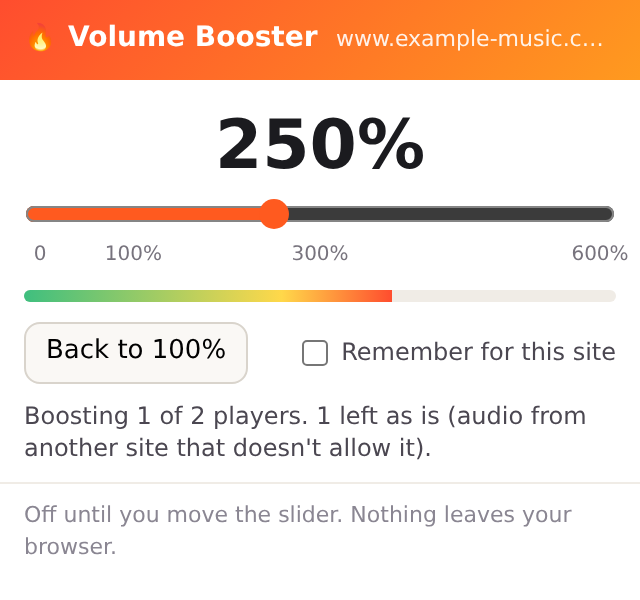

# Loudfire: a volume booster that doesn't mute other sites

Most Firefox volume boosters hook every page you open, and their reviews keep reporting the same thing: sound gone on
Netflix, Bandcamp or Imgur. Two browser rules explain most of it. Route another site's audio through Web Audio without
that site's permission (CORS) and you get silence. Protected (DRM) video can't be routed at all. And an audio element
can't be un-routed afterwards, so the page stays silent until you reload.

Loudfire does two things differently:

1. It does nothing until you move the slider on a tab. Other tabs and sites are never touched.
2. Before it routes a player, it checks that the audio will stay audible: same-site, `blob:` and streaming (MediaSource)
   media, or media loaded with CORS. Protected (DRM) video and other sites' audio without CORS are left alone, at
   normal volume, and the popup tells you so.

Up to 600%, with a limiter so loud parts don't crackle. A live meter shows what's coming out. Tick "Remember for this
site" and that site gets your level back on every visit (Firefox asks you to allow that one site).

## What it can't do

It can't boost DRM video (Netflix, Prime Video, Disney+) or audio a site serves from another domain without CORS.
Nothing in a Firefox add-on can: Firefox has no way for an add-on to capture a whole tab's sound. Loudfire tells you
when that's the case instead of going silent.

## Tests

- `tests/chromium_audio.py`: loads the add-on in Chrome for Testing, plays a same-site and a cross-site tone. At 300%
  the meter goes from 0.150 to 0.450, the cross-site player is skipped and keeps playing.
- `tests/real.sh`: installs the add-on in a real Firefox, drives the popup, checks no player is routed into silence.

Made by Prometheus. MIT licence. [Privacy](PRIVACY.md): it collects nothing.
